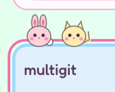
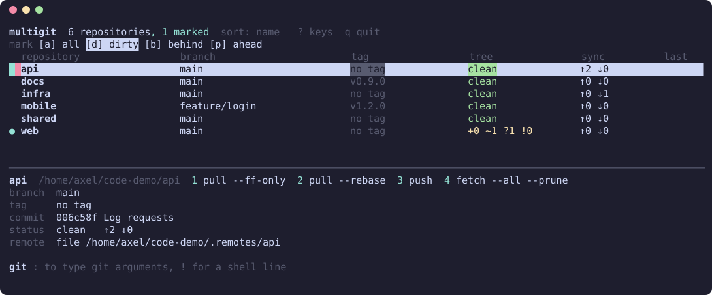

# multigit

<p>
  <a href="https://github.com/paxel/multigit/actions/workflows/ci.yml"></a>
  <a href="https://github.com/paxel/multigit/actions/workflows/security.yml"></a>
  <a href="https://github.com/paxel/multigit/actions/workflows/codeql.yml"></a>
  <a href="https://sonarcloud.io/summary/new_code?id=paxel_multigit"></a>
  <a href="https://sonarcloud.io/component_measures?id=paxel_multigit&metric=coverage"></a>
  <a href="https://sonarcloud.io/summary/overall?id=paxel_multigit"></a>
  <a href="https://github.com/paxel/multigit/releases/latest"></a>
  
  
  
</p>



A desktop dashboard for many git repositories, for Linux and macOS. Every
repository is a card that shows where it stands; buttons and a command line run
git in one or many repositories at once.

## The board

Each card shows:

- the folder name, and under it the folders above it (as many as fit; the
  full path is in the tooltip)
- the branch, or `detached @ <sha>`
- the nearest tag reachable from the checked-out commit (lightweight tags
  included) and every other tag on the same commit, highest version first,
  or `no tag`
- the checked-out commit: short hash and subject
- the working tree: `clean`, or `+staged ~modified ?untracked !conflicts`
- `rebasing` or `merging` while one is in progress
- the remote the branch tracks, as a short URL with the protocol first
  (`ssh github.com/paxel/multigit`; a click copies the URL as git has it),
  and `push:` with the name of the remote the branch pushes to when that is
  another one; a right click lists the remotes, and picking one makes the
  branch track the branch of the same name there
- unpushed and unpulled commits, `no upstream`, or `upstream gone`
- the result of the last command run on it
- a failed background fetch as one red line (`Error: auth failed`, for
  example); a click on it copies everything git printed and takes the line
  off the card until a fetch fails again

Cards are sorted by folder name. The **Sort** button in the toolbar opens the
list of sort keys: name, path, branch, tag, dirty first, behind first, ahead
first. Cards without a branch or tag come last, equal cards are in name
order, and a card moves as soon as its status changes. The status of every card refreshes every
10 seconds; a background `git fetch --all --prune` runs every minute so the
unpulled count stays current. A repository with a running command is skipped by
both until the command is done, and is refreshed right after it.

The filter field at the right end of the toolbar shows only the cards whose
folder name contains the typed text (case ignored), and how many those are. A
card the filter hides keeps its mark, but nothing touches it: commands, the
toolbar's mark buttons and the right-click menu act on the shown cards only.

A refresh of a repository whose checked-out commit did not move is one
`git status`. Branches, tags and the commit line are read again after a fetch,
after a command in that repository, when the commit moved, and at least once a
minute; so a branch or tag made in a terminal can take up to a minute to show.

A card whose folder is gone or is no longer a repository stays on the board,
greyed out, and comes back by itself when the folder returns.

## Looking into a repository

A double click on a card, or **Open** in its right-click menu, opens a
read-only view of that repository over the board. It has three tabs, and
**Back** and **Forward** step through what was looked at:

- **Files**, where the view opens when the repository has changes: the
  changed files as a tree with folders that fold. Each file is listed once,
  with a letter and a color for what happened to it since the last commit
  (A added, M modified, D deleted, ! conflict), staged or not. A picked file
  shows its content when it is new, what is gone when it was deleted, and its
  diff otherwise.
- **Commits**, where it opens when the repository is clean: the history of
  the current branch, a row for each commit with the author's initials, the
  short hash, the tags on it, the title and the age. It reads on when scrolled to its end. A
  picked commit shows its hash, author, date, whole message and the branches
  and tags on it, and a click on one of these but the message copies it;
  it names the committer when that is not the author, and its parents, where
  a click goes to that commit. Below that, the files it changed with the
  lines added and removed, and a click on a file shows what the commit did
  to it.
- **Graph**: all local and remote branches as a graph of the commits that
  matter (branch tips, tags, merges, and where branches part). Runs of
  commits between them are one row that unfolds on a click. Remote branches
  that nobody has locally and that had no commit for 90 days are left out
  behind a line that shows them. A click on a commit shows it as in Commits.

A diff of more than 5000 lines is cut. The view reads the repository
again when its card notices a change and on **Refresh**; **Close** or Esc
returns to the board. The double click also marks and unmarks the card, so its
mark ends as it was. A double click on a text that copies (name, branch, tag,
commit) copies and does not open.

A right click on text in the right pane (a commit message, a diff, the
content of a file) and on the output of a command in the output panel opens a
menu: **Copy** copies the marked text and leaves it marked, **Copy all**
copies the whole text, the lines that are not on screen included.

## Favorites

A favorite is a named group of repositories with a color and, if you like, an
emoji. A repository can be in several.

- A right click on a card adds it to a favorite, takes it out of one, or makes
  a **New favorite** with it. On a marked card the menu is about all marked
  cards: filter by `etl`, mark all, right click, add to a favorite.
- Every favorite has a button in a second toolbar line (there is no such line
  without favorites). A click shows only that favorite's cards, a second click
  all again. One favorite is active at a time, together with the filter field;
  hidden cards are skipped as with the filter.
- A right click on a favorite's button edits its name, color and emoji, adds
  or removes the marked cards, or deletes it. Deleting a favorite leaves its
  repositories on the board.
- A card shows a chip for each of its favorites under its name, in the
  favorite's color with its emoji and name. A click on a chip does what the
  favorite's toolbar button does.

## Adding and removing repositories

- **+** opens a folder dialog. A repository is added as one card; any other
  folder is scanned for repositories up to two levels deep (configurable),
  without descending into repositories it finds. A folder whose `.git` is
  empty or incomplete, like one copied without its content, is no repository. Repositories already on the
  board are skipped.
- A right click on a card takes it off the board, in two ways; on a marked
  card, both act on all marked cards. Nothing on disk is touched.
  - **Remove from board**: the card is gone, and its favorites forget it.
    Adding its folder again brings it back.
  - **Hide**: the card is gone, but multigit remembers the repository: a
    later scan of the folder above it leaves it out, it keeps its favorites,
    and nothing runs on it. **Settings** lists the hidden repositories with
    **Unhide** and **Unhide all**; picking a hidden repository itself with
    **+** unhides it too.

## Running git

- **Terminal**: the `>_` button in a card's top row opens a terminal window
  with a shell in that repository. Without a terminal command in Settings,
  multigit takes `$TERMINAL`, then `xdg-terminal-exec`, then the first of
  konsole, gnome-terminal, xfce4-terminal, kitty, alacritty, foot, wezterm and
  xterm that is installed; on macOS it opens Terminal.app, and on Windows
  Windows Terminal, or a PowerShell console where Windows Terminal is missing. In a terminal
  command of your own, `{dir}` stands for the repository's folder.
- **Switching branches**: a right click on a card's branch name (or the sha of
  a detached HEAD) opens a menu for that one repository. **Switch to** lists
  its local branches and then the remote branches that have no local branch
  yet, each newest first, with a filter field; a remote branch gets its local
  tracking branch. **Create new branch** makes a branch from the checked-out
  commit and switches to it. Both run `git switch`, so git decides what
  happens to uncommitted changes, and the result is in the output panel.
- **Switching to a tag**: a right click on a card's tag line (also on
  `no tag`) lists all tags of that repository, the one made last first, with
  a filter field. A click checks the tag out with `git switch --detach`.
- **Card buttons** run in that one repository. The defaults are
  `pull --ff-only`, `pull --rebase`, `push` and `fetch --all --prune`.
- **Marking**: a click on a card marks it, a second click unmarks it; marked
  cards get a coloured border. The toolbar marks all, dirty (changes or
  an operation in progress), behind (unpulled commits) or ahead (unpushed
  commits). These buttons work like the station buttons of a radio: the
  clicked one stays pressed until another is clicked. A click on the pressed
  button marks the other cards instead (its text is struck through then), the
  next click the first ones again; a second click on **all** leaves nothing
  marked. Marking a card by hand does not release the button. A right click
  on **dirty**, **behind** or **ahead** filters the board instead: only the
  cards that fit are shown, cards come and go as their status changes, and
  the marks stay as they are. The button gets a coloured border and the
  toolbar says `showing dirty (7)`; a click on that text, a second right
  click, or a right click on **all** shows all again. This filter works
  together with the favorite and the filter field, and a card it hides keeps
  its mark and is left alone like one the filter field hides. The toolbar repeats the card buttons
  for all marked repositories.
- **Copying**: a click on a card's folder name, branch name (or the sha of a
  detached HEAD) or tag copies it to the clipboard instead of marking the
  card; a click on the path line copies the repository's full path, and a
  click on the commit line the full commit hash.
- **Command line** at the bottom: type git arguments after the fixed `git`
  label (typing `git` first anyway is fine; it is ignored); Enter runs them in
  all marked repositories. It is disabled while nothing is marked.
- **Shell lines**: a line starting with `!` runs through your login shell
  (`$SHELL -c`, or `sh -c` when `$SHELL` is empty; on Windows `pwsh -Command`, or
  `powershell -Command` when PowerShell 7 is not installed) in each marked repository's
  folder, for example `!ls | wc -l`. The label in front of the line then shows
  the shell's name. A button whose arguments start with `!` does the same.
  Shell lines always ask for confirmation first, even for one repository
  (Enter or Run confirms, Esc cancels), and get no Tab completion.

Commands run in parallel, four at a time by default. Destructive commands
(`reset --hard`, `push --force`, `clean -f`, `branch -D`, `checkout -- <paths>`,
`restore`, `stash drop`, `stash clear`) ask for confirmation before they run in
more than one repository.

The output panel above the command line keeps the last 50 commands, one
collapsible section per repository with its exit code. **Open in editor**, on
a command or on one repository's section, writes that output to a text file
and opens it with the system's default program for text files (`xdg-open` on
Linux, `open` on macOS, `explorer.exe` on Windows); the files are in the temp folder and are removed when
multigit exits. Drag its upper edge to
make it bigger. The **Output** button left of the command line hides the panel
completely and brings it back, and the app starts as it was left; while it is hidden, a mark on the button tells
about the last command: running, then green or red by its result.

### Command line keys

| Key              | Action                                                                             |
|------------------|------------------------------------------------------------------------------------|
| Tab              | Complete: one match is inserted, several fill the common prefix and open the popup |
| Tab (popup open) | Next entry                                                                         |
| Up / Down        | Popup: move. Otherwise: older / newer history entry containing what you typed      |
| Enter            | Popup: accept. Otherwise: run                                                      |
| Esc              | Close the popup                                                                    |
| Right arrow      | Accept the grey history suggestion                                                 |
| Ctrl+R           | Fuzzy search the history                                                           |

Completion offers git's subcommands and aliases, the options git reports for
a command (with descriptions for about 20 common commands), and branches,
remotes, tags and changed files of the marked repositories. A value that only
some marked repositories have is tagged `in n/m`. "Tab inserts a single
completion directly" can be turned off in Settings; Tab then always opens the
popup.

### No terminal

git and shell lines run without a terminal and without input: no password or passphrase prompts (use
ssh-agent or a credential helper), no pager, and no editor. A command that
needs an editor, such as `commit` without `-m` or `rebase -i`, fails with a
message saying so.

### Add only folders you trust

multigit runs git in every repository on the board by itself: a status query
every 10 seconds and a fetch every minute. A repository's own `.git/config` and
`.git/hooks` can name programs that git runs. A cloned repository does not
bring those along, but a folder that arrives with its `.git` directory does (an
unpacked archive, a USB stick, a shared folder), and **+** on a folder such as
`~/Downloads` adds every repository below it.

The repository view follows the same rule: its diffs are read without the
repository's external diff program and textconv filters, and without
signature checks.

For what it runs by itself, multigit switches off `core.fsmonitor`, hooks,
`ext::` remotes, the signature check of `log.showSignature` (it runs
`gpg.program`), and `remote.<name>.uploadpack` for remotes that are not
reached over SSH (over SSH it names a program on the server). Other settings
that make git run a program stay in effect, because switching them off breaks
legitimate setups such as git-lfs or a key per repository. Among them:

- clean filters (`filter.<driver>.clean`), which can run during the status query
- `core.sshCommand`, `credential.helper`, `core.gitProxy` and
  `core.alternateRefsCommand`, which can run during the fetch

So the board is no sandbox: add only folders whose origin you know.

Buttons and the command line run git as you would in a terminal, hooks and all.

## In a terminal

`multigit --tui` runs the board in the terminal instead of a window, for a
machine without a display, over SSH for example. It uses the same config,
history and repositories as the window. On Windows it is a program of its
own, `multigit-tui`, as `multigit.exe` there is a window program without a
console.



The board is a table with one row per repository: its name, branch, tag,
working tree, unpushed (`↑`) and unpulled (`↓`) commits and the last
command's result. A `!` before the name is a failed fetch. Under the table
the selected row shows everything its card shows in the window. Statuses
refresh and fetches run as in the window. No sounds and no music play in
the terminal.

Plain keys act on the board; `?` shows them all:

| Key               | Action                                                 |
|-------------------|--------------------------------------------------------|
| j / k, arrows     | Select a row (the wheel too)                           |
| g / G, Home / End | First / last row                                       |
| space             | Mark or unmark the row                                 |
| Enter             | Open the repository view (a double click too)          |
| a, d, b, p        | Mark button all, dirty, behind, ahead (p for push)     |
| D, B, P           | Show only the dirty, behind, ahead rows                |
| A                 | Show all rows again                                    |
| /                 | Type into the filter field; Enter or Esc leaves it     |
| s                 | Sort                                                   |
| :                 | Go to the command line; Esc goes back to the board     |
| x, right click    | The row's menu                                         |
| f                 | The favorites                                          |
| +                 | Add a repository, or the ones below a folder           |
| S                 | Settings and About                                     |
| 1 … 9             | Run that card button on the row                        |
| m                 | Run a card button on all marked rows                   |
| t                 | A shell in the row's folder; `exit` returns            |
| o                 | Hide or show the output panel                          |
| Tab               | Go to the output panel and back                        |
| ?                 | Show or hide the keys                                  |
| q, Ctrl+C         | Quit                                                   |

The mark keys work like the toolbar's buttons: the pressed one shows
reversed, struck through when a second press marked the other rows. A click
on a row selects and marks it.

The row's menu (`x` or a right click) has what a right click on a card has
in the window: **Switch to**, **Create new branch**, **Switch to tag** and
**Track remote** for that one repository, with the same lists (typing
filters them), adding to and removing from favorites and **New favorite**,
**Hide** and **Remove from board**, and the card's texts to copy: name, path, branch, tags,
commit hash, remote URL and the fetch error, which then leaves the row.
Copying asks the terminal to put the text on its clipboard (the OSC 52
escape), so it reaches the clipboard of the machine in front of you, also
over SSH. Terminals that do not support it copy nothing; in tmux it takes
`set-clipboard on`.

The repository view fills the terminal: the list on the left, what is
picked in it on the right. `1`, `2` and `3` pick the tabs Files, Commits and
Graph, `[` and `]` are Back and Forward, `j`/`k` and Enter (or a click) move
and pick, `J`/`K` and PgDn/PgUp scroll the right side, `r` reads the
repository again, `y` copies all of the right side, and Esc or `q` closes
it. In the Commits tab the history reads on at its end; for a picked commit
`c` lists its hash, author, mail, date, message and names to copy, `p` its
parents to go to, and Tab gives the keys to the right side, where Enter
unfolds what the commit did to a file (Tab or Esc gives them back). The
Graph tab draws the lanes with line characters; Enter on a folded run
unfolds it, and on the line of hidden old remote branches shows them. To copy a part, mark it with the terminal's own selection (Shift and drag
where the terminal leaves the mouse to multigit).

`+` asks for the folder instead of a folder dialog: `~` is the home folder,
a relative path starts where multigit was started, and Tab completes a
folder's name. It is added and scanned as with **+** in the window.

Favorites have a line over the table, each in its color. A click on one
shows only its rows, a second click all again; a right click, or `f` and the
favorite, opens what its button's right click opens in the window. The form
for a favorite has its name, and its color and emoji, which ← and → change.

`t` is the terminal button: the board steps aside for `$SHELL` (`sh` when it
is empty) in the repository's folder, and comes back when the shell ends.
The terminal command of the Settings opens windows and is not used here.

The command line works as in the window, with the same keys (see
[Command line keys](#command-line-keys)): Enter runs the line in the marked
rows, Tab completes, Ctrl+R searches the history. A shell line, or a
destructive command for more than one repository, asks first in a box:
Enter runs, Esc cancels.

The output panel shows the last commands, a section per repository with
its exit code. In the panel `j` and `k` move, Enter (or a click on the
header) folds a section, `C` clears the output, and `e` opens the command's
output, `E` the section's, in `$PAGER` (`less` when it is not set); the
board comes back when the pager ends. While the panel is hidden, a dot in
front of the command line tells about the last command: running, then green
or red.

`S` opens Settings as a page of rows: ← and → change a value, Enter toggles
or opens. The card buttons are edited there (Enter the label, `a` the git
arguments, ← and → move one, `d` removes it), and hidden repositories are
unhidden. Sounds, the Kawaii music and the terminal command are not shown.
In the terminal System, Light and Dark all use the terminal's own colors;
Kawaii paints everything in pastels and puts the bunnies and cats in front
of the rows, as text: they sleep, look up, dance, let their ears hang and
jump with a heart when clicked, as in the window, and a command that ends
well throws hearts and stars out of its row. It moves while the terminal
has focus (where the terminal reports focus). No sounds and no music.
About shows the version and the links; Enter copies a link, as there is no
browser.

In the terminal multigit writes no menu entry and no icon. With `RUST_LOG` set, its log goes to `tui.log` in
`~/.local/state/multigit` instead of the screen.

## Settings and files

**Settings** in the toolbar changes the fetch interval, the number of parallel
git processes, the folder scan depth, the terminal command, the theme (System,
Light, Dark or Kawaii), Tab's
single-match behaviour, and the card buttons (add, remove, reorder, or pick a
preset).

With **Sounds** switched on (it is off at first, in every theme), multigit
beeps when a remote commit appears on a card (its unpulled count goes up) and
boops when a local one does (its unpushed count goes up). However many cards
have news, each sound plays once and then keeps quiet for five seconds; what
your own command in multigit changed makes no sound. Settings has a volume,
and per sound a file of your own (WAV, OGG, MP3 or FLAC, its first ten
seconds), **Default** to go back to the built-in tone, and **Play** to hear
it. multigit plays through the system's player program: `afplay` on macOS,
on Linux the first of `pw-play`, `paplay`, `aplay` and `ffplay` that is
installed, and on Windows `ffplay` or else PowerShell's sound player.

The **Kawaii** theme is round and pastel, in the Fredoka font, with a rainbow
drifting behind the cards, hearts and stars floating up, cards that bob, grow
under the pointer and swing when marked, and a burst of stars on a copy.
Bunnies and cats sit on the cards: they hop about, sleep while nothing
happens, look up at a new remote commit, dance for a local one, let their
ears hang over a failed fetch and jump with a heart when clicked. A command
that ends well throws hearts and stars out of its card. It
moves while the window has focus. Without focus the picture stands still and
the app draws no more often than in the other themes, except for five seconds
after something changed on a card.

With **Kawaii music** switched on (off at first), the Kawaii theme plays lofi
beats that multigit makes itself, in five themes: Japanese traditional lofi
(a plucked string, soft keys, a flute), retro gaming lofi (the square and
triangle waves and noise drums of old consoles), Babymetal-style lofi (an
overdriven guitar, a high voice, double bass drums), Cajun porch lofi (a
banjo, a fiddle, a washtub bass, a stomping foot and a washboard, and a jaw
harp in the breaks) and trip-hop lofi (a theremin that slides from note to
note over a slow heavy beat, a sub bass and dark keys with an echo, on a
crackling record; by chance up to three bombs fall far away during a song,
very quiet and all echo, and now and then something calls out there). Each theme has five
songs of about a minute, which vary a little every time they play. A song
has two themes of four notes: most of its parts are made from the first, two
or three from the second, with melody, chords and bass. Each of the five
themes also has a motto, one phrase of two bars that is always the same notes
in the key of the song: it comes in about every second song, where the melody
rests or at the song's end, played by the lead, the long instrument or the
bass, and always in one of the theme's long breaks. Between songs come short
and long breaks between them. After each song chance decides: three times in
four the music stays in the theme, one time in four a longer break leads
into another theme: a radio being tuned, a tape that stops, a modem
dialling in, or a record that is scratched before the needle drops on the
next one. Under the switch, Settings has a checkbox for each theme: only
the checked ones play, and with a single one checked the music never leaves
it. The last checked box cannot be unchecked. Unchecking the theme that plays
ends its passage at once and starts a song of another; any other change is
heard when the music next changes its theme. A new volume is heard as soon as the slider is let go. No sound
files and no network are involved. It plays whenever the app is open in that
theme, focused or not, through the same player program as the sounds, and has
its own volume; a change of volume counts from the next passage on.

**About multigit** in the Settings window shows the version and opens the
source code, the issue tracker, a mail to the developer, the donation page and
the list of the crates in multigit with their licences.

| File                                                           | Content                                           |
|----------------------------------------------------------------|---------------------------------------------------|
| `~/.config/multigit/config.toml`                               | Repositories, favorites, buttons, settings        |
| `~/.local/state/multigit/history`                              | Command line history, last 500 entries            |
| `~/.local/share/applications/io.github.paxel.multigit.desktop` | Menu entry, written on every start (Linux only)   |
| `~/.local/share/icons/hicolor/256x256/apps/multigit.png`       | Icon (Linux only)                                 |

`XDG_CONFIG_HOME`, `XDG_STATE_HOME` and `XDG_DATA_HOME` are honoured, on macOS
as well. On Windows the config is `%APPDATA%\multigit\config.toml` and the
history `%LOCALAPPDATA%\multigit\history`, unless the XDG variables are set. If the
config file cannot be read, the app starts with defaults and does not save
over it.

## Install

### Homebrew (Linux x86_64 and macOS)

```sh
brew install paxel/tap/multigit           # Linux
brew install --cask paxel/tap/multigit    # macOS
```

On Linux the formula also puts the menu entry and icon into
`~/.local/share`; `multigit-install-icon` writes them again, and
`multigit-install-icon --uninstall` removes them before `brew uninstall`. On
macOS the app is not signed: on first start, choose **Open Anyway** in System
Settings, Privacy & Security.

### Release tarball (Linux x86_64)

Download `multigit-<version>-x86_64-linux.tar.gz` from the
[releases](https://github.com/paxel/multigit/releases), then:

```sh
tar -xzf multigit-<version>-x86_64-linux.tar.gz
multigit-<version>-x86_64-linux/install.sh
```

`install.sh` copies the binary to `~/.local/bin` and installs the menu entry
and icon. git must be installed.

### Release zip (macOS, Apple silicon and Intel)

Download `multigit-<version>-macos-universal.zip` from the
[releases](https://github.com/paxel/multigit/releases), unpack it and move
`multigit.app` to `/Applications`. The app is not signed: on first start,
right-click it and choose **Open**, or remove the quarantine flag:

```sh
xattr -dr com.apple.quarantine /Applications/multigit.app
```

An app started from the Finder or the Dock gets the system `PATH`
(`/usr/bin:/bin:/usr/sbin:/sbin`), so it runs `/usr/bin/git` from the Xcode
Command Line Tools (`xcode-select --install`), not a git from Homebrew.

To build the bundle yourself:

```sh
cargo build --release
packaging/macos/bundle.sh target/release/multigit 0.6.0 .
```

### Scoop (Windows x86_64)

```powershell
scoop bucket add paxel https://github.com/paxel/scoop-bucket
scoop install paxel/multigit
```

Scoop puts `multigit` and `multigit-tui` on the `PATH` and adds multigit to the
Start menu.

### Release zip (Windows x86_64)

Download `multigit-<version>-x86_64-windows.zip` from the
[releases](https://github.com/paxel/multigit/releases) and unpack it anywhere.
`multigit.exe` opens the window and `multigit-tui.exe` the terminal board.
[Git for Windows](https://git-scm.com/download/win) must be installed. The
programs are not signed: when Windows shows "Windows protected your PC" for a
zip downloaded in a browser, choose **More info**, then **Run anyway**. On
Windows on ARM they run through the x64 emulation.

### From source

```sh
cargo build --release
target/release/multigit
```

On Linux the app registers its menu entry pointing at the binary it was
started from.

## Development

```sh
cargo fmt --check
cargo clippy --all-targets -- -D warnings
cargo test
tool/coverage.sh    # needs cargo-llvm-cov; COVERAGE_JOBS=1 for a small machine
tool/licenses.sh    # after a change of Cargo.lock: the About page's licence list
```

The Kawaii theme's font, Fredoka, is in `assets/fonts` under the SIL Open
Font License (`assets/fonts/Fredoka-OFL.txt`). The release tarball and
`multigit.app` carry that licence text and multigit's own `LICENSE`.

Clippy denies `unsafe`, and `unwrap`, `expect`, `panic` and indexing outside
tests (`Cargo.toml`, `clippy.toml`).

CI runs these on Linux and macOS on every push and pull request, together with
CodeQL (Rust and the workflows) and OSV-Scanner on `Cargo.lock`. A notice that a
crate is unmaintained only fails the weekly Security run; accepted ones are in
`osv-scanner.toml`, each with a reason and a review date. SonarQube Cloud
analyses `summer` after every push. Pushing a
tag `vX.Y.Z` that matches the version in `Cargo.toml` builds the Linux tarball
and the macOS zip and publishes a GitHub release with that version's `CHANGELOG.md` section as release notes.
The release stops first on a failing check, a known vulnerability, an open high
or critical CodeQL alert, or line coverage below the floor in
`tool/coverage-floor.txt`.
